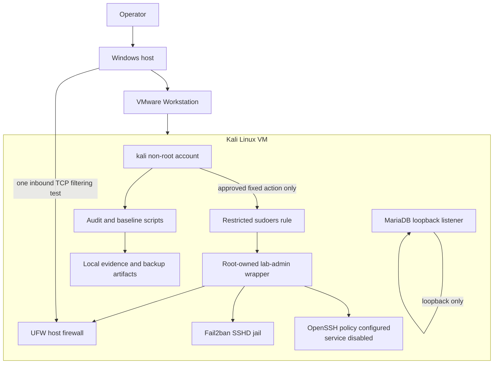

# Lab Architecture

## Purpose and scope

The project is a single Kali Linux virtual machine used to practice Linux administration and defensive hardening. The Windows host runs VMware Workstation and provides the local console and the tested host-to-guest network path. This is a lab architecture, not a production multi-tier deployment.

## Logical view

## Component responsibilities

| Component | Responsibility | Important boundary |
|---|---|---|
| Windows host / VMware | Hosts the VM and provides local console recovery | Host and hypervisor security are outside this project's full assessment |
| Kali user account | Runs normal audit and test scripts without a root shell | Some checks depend on a narrowly allowed privileged audit |
| `system_audit.sh` | Collects OS, resource, network, account, service, and security inventory | Read-only intent; output may contain sensitive host details |
| `check_security_baseline.sh` | Runs eight focused assertions and reports pass/warn/fail totals | Not a full vulnerability scanner; privileged checks rely on the wrapper |
| `lab-admin` | Executes a fixed allowlist of reviewed administrative actions | Root-owned executable; one action argument; no general shell |
| UFW | Applies host firewall policy | One host-to-guest inbound path and selected outbound tests were verified |
| Fail2ban | Loads SSHD jail policy | SSH daemon is disabled, so live ban behavior is not demonstrated |
| OpenSSH | Holds hardened server authentication policy | Service remains disabled until protected client key and login test |
| MariaDB | Provides local database service | Listener reviewed as loopback-bound |
| Backup utilities | Demonstrate sample archive/restore and provide root-only config archive script | Sample restore passed; privileged config archive remains unexecuted |

## Privileged action path

The intended administrative flow is:

1. The unprivileged `kali` user invokes `sudo -n /usr/local/sbin/lab-admin ACTION`.
2. The sudoers drop-in authorizes that exact root-owned wrapper.
3. The wrapper validates that exactly one approved action was supplied.
4. The selected fixed action performs a predefined operation and records an action log entry.
5. Any unrecognized action is rejected. The wrapper does not accept arbitrary command strings, paths, package names, or service names.

The project source is `scripts/lab-admin.sh`. Its SHA-256 was checked against the deployed executable and matched at the recorded review.

## Network and service posture

- UFW defaults: deny incoming, allow outgoing, deny routed traffic.
- Apache: disabled because it was not required.
- SSH: policy is public-key-only, but the service is intentionally disabled.
- Fail2ban: active with SSHD jail loaded; live attack response has not been tested.
- MariaDB: loopback-bound.
- Docker: daemon was active at the recorded audit; membership in the rootful Docker group remains a documented root-equivalent privilege.

## Evidence flow

Raw command output and screenshots can contain private addresses, usernames, hostnames, and inventory details. They remain in the local working copy and are ignored by Git. The public repository contains the sanitized evidence summary and documentation only.

## Trust boundaries and known gaps

- The Windows host and VMware hypervisor are trusted lab infrastructure but were not comprehensively assessed.
- Docker socket access can bypass the restricted-sudo boundary because rootful Docker group membership is root-equivalent.
- SSH remote access is not available until key provisioning, key-only login testing, and firewall review are complete.
- The system configuration backup script requires authenticated root and has not been executed.
- No VMware snapshot was created before the completed rolling upgrade.
- This architecture is a point-in-time description of the documented lab state.
